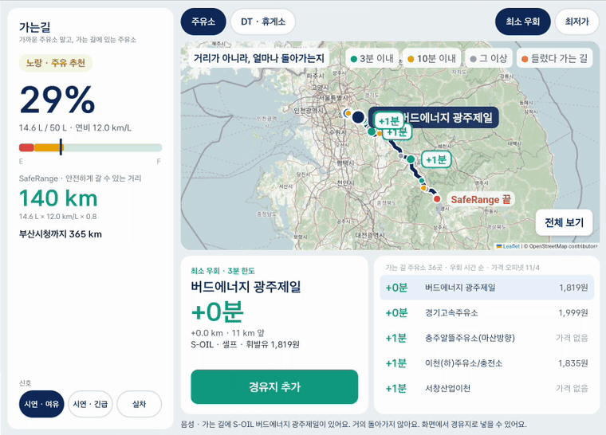
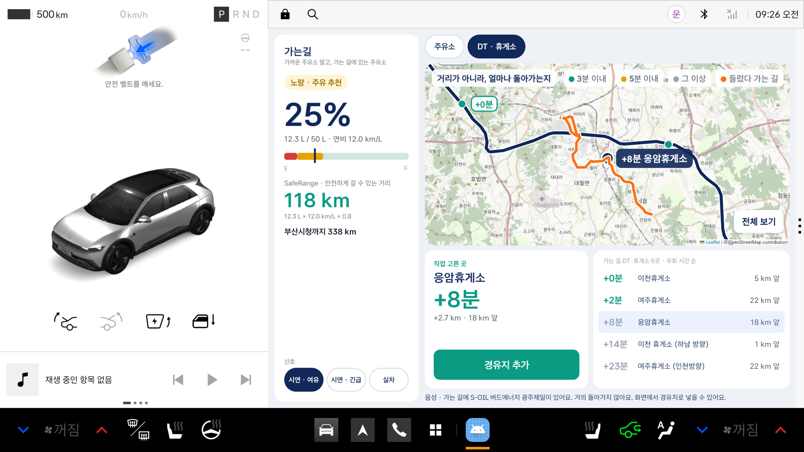
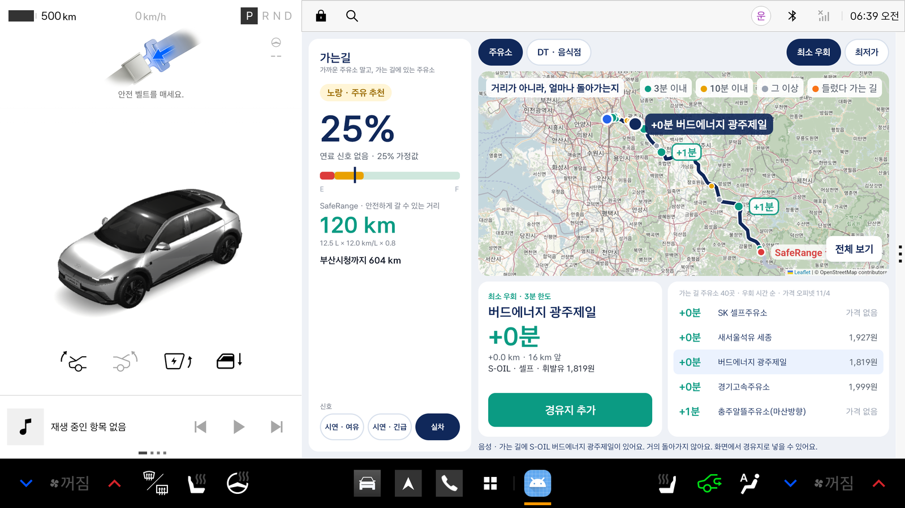

# 가는길 · 우회 없는 경유지 추가

> 현대자동차그룹 차량용 앱 개발 공모전 (Pleos Connect) · 팀 CRAVE

남은 연료를 차에서 읽고, **가는 길에서 가장 덜 돌아가는 주유소**를 알아서 Pleos 내비 경유지에 넣는 앱입니다.
가까운 주유소가 아니라, 들렀다 가도 도착이 가장 덜 늦어지는 주유소를 고릅니다.



[무엇이 다른가](#무엇이-다른가) · [동작 흐름](#동작-흐름) · [실제 데이터](#실제-데이터) · [실행 방법](#실행-방법) · [테스트 환경](#테스트-환경) · [사업성](#사업성) · [진행 상황과 다음 계획](#진행-상황과-다음-계획)

## 무엇이 다른가

- **차가 아는 연료로 계산**: Vehicle SDK의 연료 %·연비로 SafeRange(남은 연료 × 연비 × 0.8)를 구합니다. 목적지까지 갈 수 있으면 조용히 있습니다.
- **직선거리 대신, 늘어나는 시간**: 후보마다 "들렀다 가는 경로 − 원래 경로"(ΔT·ΔD)를 실제 도로망으로 계산합니다. 고속도로·IC·U턴이 그대로 반영됩니다.
- **실제 주유소, 실제 가격**: 오피넷(한국석유공사) 공개 자료의 공식 상호·상표·셀프 여부·판매가격을 씁니다.
- **실제 지도 위에 우회 경로**: 고른 주유소에 들렀다 가는 실제 길(주황)을 원래 경로(남색) 위에 그립니다.
- **찾을 필요 없음**: 노랑 단계에서 추천과 음성 안내, 빨강 단계에서는 가장 덜 돌아가는 곳을 바로 경유지로 넣습니다.

| | |
|---|---|
|  **노랑 · 최소 우회**: ΔT 3분 안에서 가장 덜 돌아가는 곳 |  **최저가**: ΔT 5분 안에서 가장 싼 곳, 최소 우회보다 몇 원 아끼는지 |
|  고속도로 휴게소 주유소는 **+1분**: 휴게소로 살짝 들어갔다 나옴 |  가까워 보여도 IC로 나갔다 와야 하면 **+8분** |
|  **빨강**: 가장 덜 돌아가는 곳을 자동으로 경유지에 + 음성 |  Pleos 내비에 "경유지 1개 포함"으로 반영 |
|  **실차 모드**: 현재 위치·목적지·남은 거리를 내비에서 받음 | |

같은 휴게소라도 내 방향 쪽은 +1분, 반대 방향 쪽은 +12분이 나옵니다. 직선으로는 둘 다 가깝지만 반대쪽은 IC로 나갔다 들어와야 하기 때문입니다.
시연을 그대로 두면 노랑 단계의 +0~2분 선택지를 지나쳐 빨강 단계에서 +7분짜리가 들어갑니다. 여유 있을 때 추천하는 이유입니다.

## 동작 흐름

| 단계 | 하는 일 | 쓰는 것 |
|---|---|---|
| 1 연료 감시 | 연료 %·연비(L/100km → km/L)·탱크 용량·유종(휘발유/경유) | Pleos **Vehicle SDK** `registerFuelPercent`, `registerCurrentFuelEconomy` · AAOS `INFO_FUEL_CAPACITY`, `INFO_FUEL_TYPE` |
| 2 단계 판단 | SafeRange로 노랑(≤ 150 km) / 빨강(≤ 50 km). 목적지까지 갈 수 있으면 조용히 | `core/Engine.kt` |
| 3 후보 수집 | 현재 위치→목적지 경로 앞쪽 SafeRange 안, 도로에서 1.5 km 이내 주유소 | Pleos **NaviHelper** `getCurrentLocationInfo`, `getDestinationInfo` + 내장 주유소 목록 |
| 4 ΔT·ΔD 계산 | 후보 전체를 한 번의 요청으로: 원래 경로 / 출발→주유소 / 주유소→목적지 | OSRM table API (OpenStreetMap 도로망) |
| 5 경유지 추가 | 모드대로 1곳 + 음성 한 문장. 바꿀 때는 경로를 한 번에 다시 요청 | Pleos **NaviHelper** `addWaypoint`, `requestRouteWithWaypoints` · Pleos **TextToSpeech** (ON_DEVICE, 앱 등록 불필요) |

- **최소 우회**(기본): ΔT 3분·ΔD 2 km 안에서 ΔT가 가장 작은 곳. 오피넷에서 확인된 주유소를 먼저 고릅니다.
- **최저가**(탭): ΔT 5분·ΔD 3 km 안에서 가장 싼 곳. 더 돌아가며 쓰는 연료값을 빼고 "가득 주유 시 몇 원 아끼는지" 보여 줍니다.
- **DT·휴게소** 탭: 같은 우회 계산으로 드라이브스루·고속도로 휴게소를 ΔT 순으로. 이름이 같은 양방향 휴게소는 덜 돌아가는 쪽만 남깁니다.
- 한도 값은 실제 경로 8개(고속도로·국도·도심)로 정했습니다. ΔT 3분은 8개 경로 모두에서 후보가 3곳 이상 남는 가장 작은 한도입니다 → [docs/calibration.md](docs/calibration.md)

## 실제 데이터

| 무엇 | 출처 | 규모 |
|---|---|---|
| 주유소 상호·상표·셀프·가격 | [오피넷 유가내려받기](https://www.opinet.co.kr/user/opdown/opDownload.do) (한국석유공사) "사업자 기본정보", "사업자별 현재 판매가격" | 전국 10,315곳, 가격 기준일 2026-11-04 |
| 주유소 위치 | 오피넷 API 공식 좌표를 먼저 쓰고, 나머지는 오피넷 주소를 OpenStreetMap 주유소·건물 주소·고속도로 휴게소와 맞춰 붙임 ([방식과 정확도](docs/stations.md)) | 오피넷 **4,003곳**(공식 좌표 296곳) + 오피넷과 이어지지 않은 OSM 주유소 2,901곳(가격 정보 없음으로 표시) |
| DT·휴게소 | OpenStreetMap | 983곳 |
| 도로망·경로 | OSRM (OpenStreetMap) | 실시간 |
| 지도 | OpenStreetMap 타일 (Leaflet, 앱이 받아 기기에 캐시) | 실시간 |

오피넷 내려받기 자료에는 좌표가 없어서 위치는 이렇게 붙였습니다(확실한 순): 오피넷 API 공식 좌표 → 같은 시군구의 같은 이름 OSM 주유소 → 같은 이름·방향의 고속도로 휴게소 → 같은 도로명주소의 OSM 건물 → 같은 도로의 OSM 주유소 → 같은 도로·같은 쪽 건물번호 보간.
"같은 도로" 방식은 이름으로 확실한 916곳에 시험해 94%가 정확히 같은 주유소를 골랐고, 보간은 중앙값 13 m 오차였습니다. 위치를 못 찾은 오피넷 주유소는 틀린 자리에 두지 않으려고 뺐습니다.
공식 좌표를 받은 곳 중 매칭 위치가 있던 212곳을 비교하니 19곳(9%)이 1 km 넘게 틀렸습니다. 이 곳들은 공식 좌표로 고쳤지만, 아직 매칭 위치를 쓰는 주유소에는 같은 오차가 남아 있을 수 있습니다.

## 실행 방법

### APK 설치

```bash
adb install -r apk/CRAVE_OnTheWay_release.apk
```

Pleos Connect 에뮬레이터 앱 목록에서 **가는길**을 엽니다. 왼쪽 아래 버튼으로 신호를 고릅니다.

- **시연 · 여유**: 내비의 현재 위치(에뮬레이터 기본값: 판교)에서 부산시청까지 1초에 1 km씩 달립니다. 연료 30%로 출발해 노랑 추천과 음성이 나오고, 그대로 두면 빨강 단계에서 자동으로 경유지가 들어갑니다. 경유지를 지나면 주유(90%)로 처리됩니다.
- **시연 · 긴급**: 연료 9%로 출발해 바로 빨강 → 자동 경유지 + 음성.
- **실차**: 연료·연비는 Vehicle SDK, 위치·목적지·남은 거리는 Pleos 내비에서 받습니다. 내비에서 목적지를 정하면 계산합니다.
  Pleos 에뮬레이터 차량은 전기차라 `FUEL_PERCENT`가 없어서, 이때는 연료 25%를 가정값으로 쓰고 화면에 "가정값"으로 표시합니다.

목록에서 주유소를 누르면 지도가 그 주유소에 들렀다 가는 실제 길로 확대됩니다. "전체 보기"로 돌아옵니다.
시연 시작과 경유지 추가 때 Pleos 내비가 앞으로 나와 경로를 보여 주고, 2.5초 뒤 앱으로 돌아옵니다.

### 확인한 것 (Pleos Connect Emulator v2.1.0, release APK)

- 시연 · 여유: 노랑 추천 + 음성 → 최저가 전환 → 우회 경로 확대 → 경유지 추가 → 내비 "경유지 1개 포함" → 경유지 통과 시 주유 → 여유 단계
- 시연 · 긴급, 여유 방치: 빨강 단계에서 자동 경유지 추가 + 음성
- 실차: 내비 현재 위치·목적지(부산시청)·남은 거리 수신, 연료 가정값으로 추천
- Pleos TextToSpeech ON_DEVICE 발화 (onStart → onDone 로그)
- `./gradlew :core:test` 20개 통과
- 공식 좌표를 반영해 다시 빌드한 APK: 시작 화면 주유소 6,904곳 표시, 시연 · 긴급에서 자동 경유지 → 음성 → 주유 처리까지 동작

### 소스에서 빌드

```bash
cd android
export JAVA_HOME="/Applications/Android Studio.app/Contents/jbr/Contents/Home"
./gradlew :core:test :app:assembleDebug     # 엔진 단위 테스트 + 디버그 APK
./gradlew :core:calibrate                    # (네트워크) 한도 값 근거 다시 계산 → docs/calibration.md
./gradlew :core:savings                      # (네트워크) 우회 시간·주유비 절약 측정 → docs/savings.md
```

release 빌드는 `android/local.properties`에 서명 정보를 넣고 `./gradlew :app:assembleRelease` (키·비밀번호는 커밋하지 않음):

```
release.storeFile=/path/to/release.jks
release.storePassword=…
release.keyAlias=…
release.keyPassword=…
```

주유소 데이터 다시 만들기 (`data/opinet/`의 오피넷 원본 + OpenStreetMap 한국 추출본, 약 290 MB):

```bash
curl -LO https://download.geofabrik.de/asia/south-korea-latest.osm.pbf
brew install osmium-tool && pip install shapely
python3 tools/build_places.py data/opinet/사업자_기본정보_주유소_20261104.csv data/opinet/현재_판매가격_주유소_20261104.csv south-korea-latest.osm.pbf
```

새 가격은 오피넷 유가내려받기에서 두 CSV를 다시 받아 같은 명령을 돌리면 됩니다(로그인 불필요).

공식 좌표는 오피넷 API 키를 `android/local.properties`에 `opinet.key=…`로 넣고 받습니다. 키가 300회 호출 뒤 응답을 멈춰서 매일 다시 실행하면 멈춘 곳부터 이어 받습니다. 받은 뒤 위의 `build_places.py`를 다시 돌리면 `data/opinet/api_stations.csv`가 반영됩니다.

```bash
pip install pyproj
python3 tools/fetch_opinet.py data/opinet/사업자_기본정보_주유소_20261104.csv
```

## 테스트 환경

- macOS (Apple Silicon), Android Studio + JBR 25, Android SDK 34, AGP 9.4.1, Gradle 9.8.2, Kotlin 2.4
- Pleos Connect Emulator v2.1.0 (API 34, arm64, 2560×1440), Virtual Console
- Pleos SDK: Vehicle 2.3.2, NaviHelper 3.0.5, TextToSpeech 3.3.1
- 네트워크: 경로(OSRM)와 지도 타일(OpenStreetMap)에 필요. 같은 요청·타일은 기기에 캐시되어 다시 볼 때는 오프라인으로도 됩니다. 주유소 목록과 가격은 앱에 들어 있습니다.
- 시연이 "신호를 기다리는 중"에서 멈추면 에뮬레이터 DNS 문제일 수 있습니다. `emulator -avd <AVD 이름> -dns-server 8.8.8.8`로 다시 시작합니다.

## 폴더

```
android/
  core/   순수 Kotlin 엔진: SafeRange, 단계, 코리도, OSRM 파싱, 우회 구간, 선택 규칙 + 단위 테스트 + calibrate
  app/    Pleos 앱: 차량 신호(Vehicle), 내비(NaviHelper), 음성(TextToSpeech), 시연 주행, 화면, 지도
  app/src/main/assets/places.csv    주유소·DT·휴게소 (tools/build_places.py가 만듦)
  app/src/main/assets/map.html      실제 지도 (Leaflet 내장)
data/opinet/                        오피넷 원본 CSV (2026-11-04), API 공식 좌표 (api_stations.csv)
tools/build_places.py               places.csv 생성
tools/fetch_opinet.py               오피넷 API 공식 좌표 수집
docs/calibration.md                 ΔT·ΔD 한도 근거
docs/savings.md                     우회 시간·주유비 절약 측정
docs/stations.md                    주유소 위치 매칭 결과와 정확도
apk/CRAVE_OnTheWay_release.apk      제출용 release APK
```

## 사업성

> **최종 목표:** 앱을 열지 않아도 내비가 연료 부족을 판단해 최적 주유소를 경유하는 경로를 자동으로 설정합니다. 현재 프로토타입은 앱이 실행 중일 때 빨강 단계에서 경유지를 자동으로 넣습니다.
>
> MAU와 Retention은 출시 전 모델 추정치이며, 출시 후 실측값으로 바꿉니다. **(가정)** 표시는 공개 자료가 없어 팀이 정한 값입니다.

### 타깃 고객

타깃은 **차를 쓰는 모든 운전자**입니다. 먼저 주유가 필요한 차부터 지원하고, 충전소를 지원하면 전기·LPG 차까지 넓힙니다. 가는길은 목적지까지 연료가 모자랄 때 안내하므로, 먼 길일수록 일찍 알려 줍니다.

| 목적지까지 거리 | 추천이 시작되는 남은 연료 (탱크 50 L, 연비 12 km/L) |
|---|---|
| 20 km | 2.1 L (4%) |
| 100 km | 10.4 L (21%) |
| 150 km 이상 | 15.6 L (31%) |

| 시장 단계 | 규모 | 기준 |
|---|---|---|
| 국내 등록 차량 | 2,667.6만대 | 2026년 6월 말 |
| 휘발유·경유·하이브리드 | 2,352.4만대 (88%) | 2026년 6월 말 |
| 지금 설치 가능한 차 | 최대 약 5.3만대 | 그랜저 6~10월 + 아반떼 9~10월 국내 판매 합 |
| 2030년 국내 탑재 연료차 | 약 242만대 | 그룹 목표 2,000만대 × 국내 판매 비중 17.3% × 연료차 70%(가정) |

네이버 오토앱은 연료가 부족하면 주변 주유소를 안내하고, 티맵은 음성 요청으로 주유소를 경유지에 넣습니다. 카카오내비 AI는 주유소를 찾을 때 경로상 위치를 보여 줍니다. 가는길은 주변이 아니라 가는 길을 기준으로, 늘어나는 시간을 계산해 주유소를 고르고 경유지까지 넣습니다.

### 예상 MAU

모든 차의 내비에 탑재되어 주유와 DT 경유를 내비가 처리하는 상태를 전제로 한 **상한**입니다(가정).

`MAU 상한 = 탑재 연료차 × 그 달에 주유 또는 DT를 1회 이상 이용하는 차량 비율(86.5%)`

| 시점 | 탑재 연료차 | MAU 상한 | 월 이용 횟수 상한 |
|---|---|---|---|
| 2028년 말 (그랜저·아반떼) | 약 43만대 (가정) | 37만 | 135만회 |
| 2030년 말 (Pleos 탑재 전체) | 약 242만대 (가정) | 209만 | 759만회 |
| 국내 연료차 전체 | 2,352만대 | 2,034만 | 7,370만회 |

국내 전체 값 2,034만은 티맵 MAU 1,512만(2026년 5월)보다 큽니다. 모든 내비 탑재를 가정한 이론적 상한이며, 실제 MAU는 탑재 범위와 내비 사용 습관에 따라 더 낮습니다. 2028년 말 대수는 2026년 9~10월 평균 판매인 월 14,461대가 유지된다는 가정입니다.

차량 한 대의 월평균 이용은 **주유 2.8회 + DT 0.3회(가정) = 3.1회**입니다.

| 운행 빈도 | 비중 | 월 운행일 (대표값, 가정) | 그 달 이용 확률 |
|---|---|---|---|
| 주 5회 이상 | 49% | 26일 | 99% |
| 주 3~4회 | 22% | 15일 | 95% |
| 주 1~2회 | 19% | 6.5일 | 73% |
| 주 1회 미만 | 11% | 2일 | 35% |

주유만 월 2.4~3.9회로 바꾸면 이용 차량 비율은 83.7~90.6%, DT만 월 0.1~1.0회로 바꾸면 85.4~89.4%입니다. Pleos 순정 내비만 쓰는 경우 국산차 순정 내비 이용률 68%를 적용하면 2030년 MAU 상한은 142만입니다. 스마트폰 내비 이용자까지 닿으려면 내비 제휴가 필요합니다.

### Retention Rate

이번 달에 이용한 차가 N개월 뒤 그 달에 다시 이용할 비율입니다. 운행 빈도와 주유·DT 횟수만 반영한 값은 **91%**입니다. 여기에 추천을 끄거나 다른 내비로 옮기는 이탈을 월 2%(가정)로 넣었습니다.

| 기간 | 1개월 | 3개월 | 6개월 | 12개월 | 24개월 |
|---|---|---|---|---|---|
| Retention | 90% | 86% | 81% | 72% | 56% |

내비 기본 기능이 되면 앱을 찾아서 다시 열 필요가 없고, 주유 주기마다 쓸 일이 생깁니다. 일반 앱의 Day 30 유지율(여행 앱 iOS 3.1%, Android 2.8%, 전체 평균 7.88%)은 앱을 다시 여는 기준이라 직접 비교할 수 없습니다. 현재 프로토타입은 앱을 직접 열어야 하므로, 위 수치는 내비 내장 후의 값입니다.

### 사업성 지표

| 지표 | 값 | 기준 |
|---|---|---|
| 1회 우회 시간 절약 | 중앙값 **7.1분** | 직선 최단 주유소 +7.1분, 가는길 +0.2분 (32지점 측정) |
| 1회 주유비 절약 | 중앙값 **2,882원** | 최저가 모드, 33 L 주유, 추가 연료비 차감 (비교 가능한 31지점 모두 절약) |
| 차량 1대 연간 가치 | 1.4시간, 3.5만원 | 월 1회 이용(가정) |
| 2030년 연간 절약 총량 | 약 340만 시간, 약 840억원 | 242만대(가정), 월 1회 이용(가정) |
| 연간 주유 거래액 | 1대 174만원, 2030년 4.2조원 | 연 11,242 km, 12 km/L(앱 기본값), 1,855원/L |
| 제휴 수익 시나리오 | 1대 연 937원, 2030년 23억원, 국내 전체 220억원 | 결제 연동 10%(가정), 리터당 10원(가정) |
| DAU/MAU | 약 12% | 활성 차량당 월 3.6회 이용 |

절약 측정은 앱과 같은 코드로 경로 8개의 32지점을 돌려, 그 지점에서 직선으로 가장 가까운 오피넷 주유소와 비교한 값입니다([docs/savings.md](docs/savings.md)). 실시간 교통은 반영하지 않았고, 가격은 2026-11-04 오피넷 기준입니다. 직선 최단은 비교 기준이며 실제 운전자의 선택을 잰 값은 아닙니다.

출시 후에는 추천 수락률, 경유지 완주율, 자동 경로 취소율, 실제 절약 시간을 익명 이벤트로 측정합니다.

### 향후 서비스 확대 계획

| 단계 | 시기 (가정) | 할 일 | 목표 |
|---|---|---|---|
| 1. 상용 준비 | 2027 상반기 | 시동 시 자동 감시, 오피넷 API로 위치 없는 6,312곳과 실시간 가격 반영, 오피넷 자료 상용 이용 협의, 비상업용 OSRM 공개 서버를 상용 경로 API로 교체 | 추천 품질 |
| 2. 앱 마켓 출시 | 2027 하반기 | Pleos App Market 검증·심사, 익명 지표 측정 | 실사용 데이터 확보 |
| 3. 내비 제휴 | 2028 | **네이버지도·카카오내비·티맵**에 우회 계산 엔진을 API로 제공 | 스마트폰 내비 이용자 확대 |
| 4. 대상 확대 | 2029 | 적용 차종 확대 대응, 전기·LPG 충전소 추천, 인카페이먼트 주유 결제 연동 | 대상 차량, 수익화 |
| 5. 최종 목표 | 2030 | 내비 기본 기능화: 연료가 부족하면 내비가 최적 주유소 경유 경로를 자동 설정, 이후 글로벌 확대 | 모든 내비 탑재 |

네이버지도와 카카오내비는 이미 플레오스 커넥트에 입점해 있어 먼저 제안하고, 스마트폰 내비 점유율 1위인 티맵(71.9%, 네이버지도 14.5%, 카카오내비 9.2%)까지 넓힙니다. 앱 마켓 입점과 제휴는 심사·협의가 필요하며 확정된 사항이 아닙니다. 사용자에게는 무료로 제공하고 광고비로 추천 순서를 바꾸지 않습니다.

<details>
<summary>계산 근거와 출처</summary>

- **주유:** 자가용 승용차 월평균 3.9회, 주평균 운행 5.5일 ([KTDB 자동차이용실태조사 2012](https://www.ktdb.go.kr/site/www/dowonload/car/2012_survey01.pdf)). 운행일당 16.3% × 평균 운행 17.4일 = 월 2.8회. 1회 주유량 33.0 L로 소비량을 환산한 값은 월 2.4회입니다.
- **운행 빈도:** [나우앤서베이 2020, 1,505명](https://www.datasom.co.kr/news/articleView.html?idxno=104444). 그 달 이용 확률 = 1 − (1 − 운행일당 이용 확률 18.05%)^월 운행일.
- **DT:** 공식 통계가 없어 역산했습니다. [스타벅스 2025년 매출 3조2,380억원, 매장 2,114곳](https://v.daum.net/v/btFjkI4qkz) ÷ 객단가 8,000원(가정) × DT 주문 40%(가정) = 매장당 일 210대. [스타벅스 DT 500곳](https://ceoscoredaily.com/page/view/2024122015353652370) + [맥드라이브 300곳](https://www.hankyung.com/article/202507211177i)에 적용하고, 다른 브랜드 30%(가정)를 더해 월 664만대 ÷ 2,352만대 = 0.3회.
- **시장:** [등록 대수](https://www.mt.co.kr/estate/2026/07/30/2026072915093667802), [플레오스 커넥트 2,000만대](https://zdnet.co.kr/view/?no=20260430015244), [앱 마켓 18종](https://www.fnnews.com/news/202609070949054267), [주행거리](https://www.fnnews.com/news/202606291005221113)
- **판매:** 현대차 [6월](https://www.hyundaimotorgroup.com/ko/news/hyundai-motor-company-june-2026-sales), [7월](https://www.hyundaimotorgroup.com/ko/news/hyundai-motor-company-july-2026-sales), [8월](https://www.hyundaimotorgroup.com/ko/news/hyundai-motor-company-august-2026-sales), [9월](https://www.hyundaimotorgroup.com/ko/news/hyundai-motor-company-september-2026-sales), [10월](https://www.hyundaimotorgroup.com/ko/news/hyundai-motor-company-october-2026-sales), [현대차 2025](https://www.hyundaimotorgroup.com/ko/news/hyundai-motor-company-sales-4138180-units-2025), [기아 2025](https://www.hyundaimotorgroup.com/ko/news/kia-2025-sales-3135803-units)
- **내비:** [순정 내비 68%](https://www.consumerinsight.co.kr/autoinsight/abview?no=3294&id=pr4_list), [앱 점유율](http://www.breaknews.com/1248191), [지도 앱 MAU](https://www.igaworks.com/blog/outstanding-0618), [네이버](https://www.kukinews.com/article/view/kuk202606260026), [티맵](https://www.hankyung.com/article/202509179328i), [카카오내비](https://www.inews24.com/view/1963419)
- **기타:** [Retention(Braze, AppsFlyer 재인용)](https://www.braze.com/resources/articles/mobile-app-retention.md), [Stream(OneSignal 재인용)](https://getstream.io/blog/app-retention-guide/), [인카페이먼트](https://www.genesis.com/kr/ko/members/my-genesis-app/mobility-services/in-car-payment.html), [OSRM 정책](https://github.com/Project-OSRM/osrm-backend/wiki/Demo-server)

</details>

## 진행 상황과 다음 계획

### 지금까지 한 것

- **Pleos 앱:** 연료 감시, 노랑·빨강 단계 판단, ΔT·ΔD 계산, 최소 우회·최저가 선택, DT·휴게소 탭, 내비 경유지 추가, 음성 안내, 실제 지도, 시연·실차 모드
- **데이터:** 오피넷 전국 10,315곳의 상호·가격, 그중 4,003곳의 위치, OSM 주유소 2,901곳, DT·휴게소 983곳
- **오피넷 API 연결:** 공식 좌표 296곳 반영, 매칭 위치의 실제 오차 측정
- **근거 측정:** 경로 8개로 ΔT·ΔD 한도 결정, 32지점에서 우회 시간·주유비 절약 측정, 엔진 단위 테스트 20개
- **사업성 분석:** 타깃 고객, MAU, Retention, 사업성 지표, 서비스 확대 계획

### 앞으로 할 것

우선순위 순입니다. 시기와 장기 단계는 [향후 서비스 확대 계획](#향후-서비스-확대-계획)을 따릅니다.

1. **공식 좌표 수집 마무리:** 매일 이어 받아 위치 없는 6,312곳을 채우고 매칭 오차를 없앱니다.
2. **시동 시 자동 감시:** 앱을 열지 않아도 연료를 감시합니다.
3. **실시간 가격:** 앱 데이터 대신 오피넷 API로 주행 중 가격을 받습니다.
4. **실시간 교통 경로:** OSRM 공개 서버를 상용 경로 API로 바꿔 막힌 길을 피하는 경유지(ΔT < 0)도 잡습니다.
5. **오피넷 자료 이용 협의:** 앱 배포와 수익 활용을 한국석유공사와 협의합니다.
6. **마지막 기회 안내:** 노랑 단계 추천을 지나치기 전에 "이곳을 지나면 +N분"을 알립니다.
7. **충전소 지원:** 같은 계산을 전기차 충전소에 적용합니다(SafeRange를 배터리·전비로).
8. **최종 목표:** 앱을 열지 않아도 내비가 연료 부족 시 최적 주유소 경유 경로를 자동으로 설정합니다.

### 현재 한계

- 앱을 직접 열어야 동작합니다. 시동 시 자동 시작은 아직 없습니다.
- 오피넷 주유소 6,312곳은 위치를 못 붙여 빠졌고, 공식 좌표가 없는 곳은 매칭 오차가 남아 있습니다.
- 가격은 내려받은 날 기준입니다(화면에 "오피넷 11/4" 표시).
- ΔT는 실시간 교통을 반영하지 않습니다(OSRM).
- 실제 차량이 아닌 Pleos 에뮬레이터에서 확인했고, 에뮬레이터 차량은 전기차라 실차 모드의 연료는 가정값입니다.

## 데이터 출처

- 주유소 정보·가격·공식 좌표: 한국석유공사 오피넷 (저작권은 한국석유공사에 있으며, 수익 목적 이용은 사전 협의 필요)
- 지도·도로·위치·DT·휴게소: © OpenStreetMap contributors (ODbL)
- 경로: OSRM (Project OSRM 공개 서버)
- 지도 라이브러리: Leaflet 1.9.4 (BSD-2-Clause, `android/app/src/main/assets/leaflet/LICENSE`)
