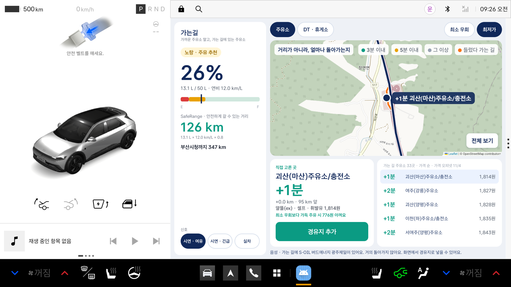
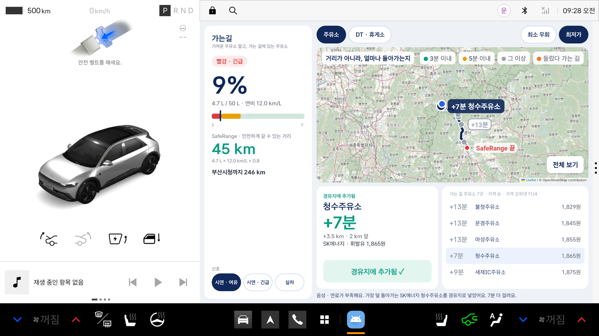
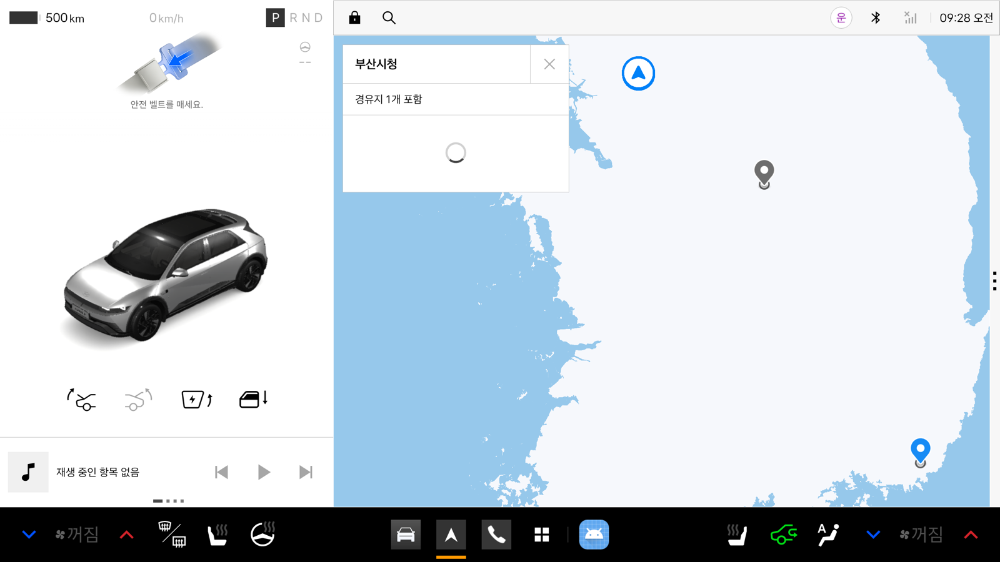

# 가는길 · 우회 없는 경유지 추가

> 현대자동차그룹 차량용 앱 개발 공모전 (Pleos Connect) · 팀 CRAVE

남은 연료를 차에서 읽고, **가는 길에서 가장 덜 돌아가는 주유소**를 알아서 Pleos 내비 경유지에 넣는 앱입니다.
가까운 주유소가 아니라, 들렀다 가도 도착이 가장 덜 늦어지는 주유소를 고릅니다.


## 무엇이 다른가

- **차가 아는 연료로 계산**: Vehicle SDK의 연료 %·연비로 SafeRange(남은 연료 × 연비 × 0.8)를 구합니다. 목적지까지 갈 수 있으면 조용히 있습니다.
- **직선거리 대신, 늘어나는 시간**: 후보마다 "들렀다 가는 경로 − 원래 경로"(ΔT·ΔD)를 실제 도로망으로 계산합니다. 고속도로·IC·U턴이 그대로 반영됩니다.
- **실제 주유소, 실제 가격**: 오피넷(한국석유공사) 공개 자료의 공식 상호·상표·셀프 여부·판매가격을 씁니다.
- **실제 지도 위에 우회 경로**: 고른 주유소에 들렀다 가는 실제 길(주황)을 원래 경로(남색) 위에 그립니다.
- **찾을 필요 없음**: 노랑 단계에서 추천과 음성 안내, 빨강 단계에서는 가장 덜 돌아가는 곳을 바로 경유지로 넣습니다.

| | |
|---|---|
|  **노랑 · 최소 우회**: ΔT 3분 안에서 가장 덜 돌아가는 곳 |  **최저가**: ΔT 5분 안에서 가장 싼 곳, 최소 우회보다 몇 원 아끼는지 |
|  고속도로 휴게소 주유소는 **+1분**: 휴게소로 살짝 들어갔다 나옴 |  가까워 보여도 IC로 나갔다 와야 하면 **+8분** |
|  **빨강**: 가장 덜 돌아가는 곳을 자동으로 경유지에 + 음성 |  Pleos 내비에 "경유지 1개 포함"으로 반영 |
|  **실차 모드**: 현재 위치·목적지·남은 거리를 내비에서 받음 | |

같은 휴게소라도 내 방향 쪽은 +1분, 반대 방향 쪽은 +12분이 나옵니다. 직선으로는 둘 다 가깝지만 반대쪽은 IC로 나갔다 들어와야 하기 때문입니다.
시연을 그대로 두면 노랑 단계의 +0~2분 선택지를 지나쳐 빨강 단계에서 +7분짜리가 들어갑니다. 여유 있을 때 추천하는 이유입니다.

## 동작 흐름

| 단계 | 하는 일 | 쓰는 것 |
|---|---|---|
| 1 연료 감시 | 연료 %·연비(L/100km → km/L)·탱크 용량·유종(휘발유/경유) | Pleos **Vehicle SDK** `registerFuelPercent`, `registerCurrentFuelEconomy` · AAOS `INFO_FUEL_CAPACITY`, `INFO_FUEL_TYPE` |
| 2 단계 판단 | SafeRange로 노랑(≤ 150 km) / 빨강(≤ 50 km). 목적지까지 갈 수 있으면 조용히 | `core/Engine.kt` |
| 3 후보 수집 | 현재 위치→목적지 경로 앞쪽 SafeRange 안, 도로에서 1.5 km 이내 주유소 | Pleos **NaviHelper** `getCurrentLocationInfo`, `getDestinationInfo` + 내장 주유소 목록 |
| 4 ΔT·ΔD 계산 | 후보 전체를 한 번의 요청으로: 원래 경로 / 출발→주유소 / 주유소→목적지 | OSRM table API (OpenStreetMap 도로망) |
| 5 경유지 추가 | 모드대로 1곳 + 음성 한 문장. 바꿀 때는 경로를 한 번에 다시 요청 | Pleos **NaviHelper** `addWaypoint`, `requestRouteWithWaypoints` · Pleos **TextToSpeech** (ON_DEVICE, 앱 등록 불필요) |

- **최소 우회**(기본): ΔT 3분·ΔD 2 km 안에서 ΔT가 가장 작은 곳. 오피넷에서 확인된 주유소를 먼저 고릅니다.
- **최저가**(탭): ΔT 5분·ΔD 3 km 안에서 가장 싼 곳. 더 돌아가며 쓰는 연료값을 빼고 "가득 주유 시 몇 원 아끼는지" 보여 줍니다.
- **DT·휴게소** 탭: 같은 우회 계산으로 드라이브스루·고속도로 휴게소를 ΔT 순으로. 이름이 같은 양방향 휴게소는 덜 돌아가는 쪽만 남깁니다.
- 한도 값은 실제 경로 8개(고속도로·국도·도심)로 정했습니다. ΔT 3분은 8개 경로 모두에서 후보가 3곳 이상 남는 가장 작은 한도입니다 → [docs/calibration.md](docs/calibration.md)

## 실제 데이터

| 무엇 | 출처 | 규모 |
|---|---|---|
| 주유소 상호·상표·셀프·가격 | [오피넷 유가내려받기](https://www.opinet.co.kr/user/opdown/opDownload.do) (한국석유공사, 무료·이용 제한 없음) "사업자 기본정보", "사업자별 현재 판매가격" | 전국 10,315곳, 가격 기준일 2026-11-04 |
| 주유소 위치 | 오피넷 주소를 OpenStreetMap 주유소·건물 주소·고속도로 휴게소와 맞춰 붙임 ([방식과 정확도](docs/stations.md)) | 오피넷 **3,919곳** + 오피넷과 이어지지 않은 OSM 주유소 2,937곳(가격 정보 없음으로 표시) |
| DT·휴게소 | OpenStreetMap | 983곳 |
| 도로망·경로 | OSRM (OpenStreetMap) | 실시간 |
| 지도 | OpenStreetMap 타일 (Leaflet, 앱이 받아 기기에 캐시) | 실시간 |

오피넷 자료에는 좌표가 없어서 위치는 이렇게 붙였습니다(확실한 순): 같은 시군구의 같은 이름 OSM 주유소 → 같은 이름·방향의 고속도로 휴게소 → 같은 도로명주소의 OSM 건물 → 같은 도로의 OSM 주유소 → 같은 도로·같은 쪽 건물번호 보간.
"같은 도로" 방식은 이름으로 확실한 916곳에 시험해 94%가 정확히 같은 주유소를 골랐고, 보간은 중앙값 13 m 오차였습니다. 위치를 못 찾은 오피넷 주유소는 틀린 자리에 두지 않으려고 뺐습니다.

## 실행 방법

### APK 설치

```bash
adb install -r apk/CRAVE_OnTheWay_release.apk
```

Pleos Connect 에뮬레이터 앱 목록에서 **가는길**을 엽니다. 왼쪽 아래 버튼으로 신호를 고릅니다.

- **시연 · 여유**: 내비의 현재 위치(에뮬레이터 기본값: 판교)에서 부산시청까지 1초에 1 km씩 달립니다. 연료 30%로 출발해 노랑 추천과 음성이 나오고, 그대로 두면 빨강 단계에서 자동으로 경유지가 들어갑니다. 경유지를 지나면 주유(90%)로 처리됩니다.
- **시연 · 긴급**: 연료 9%로 출발해 바로 빨강 → 자동 경유지 + 음성.
- **실차**: 연료·연비는 Vehicle SDK, 위치·목적지·남은 거리는 Pleos 내비에서 받습니다. 내비에서 목적지를 정하면 계산합니다.
  Pleos 에뮬레이터 차량은 전기차라 `FUEL_PERCENT`가 없어서, 이때는 연료 25%를 가정값으로 쓰고 화면에 "가정값"으로 표시합니다.

목록에서 주유소를 누르면 지도가 그 주유소에 들렀다 가는 실제 길로 확대됩니다. "전체 보기"로 돌아옵니다.
시연 시작과 경유지 추가 때 Pleos 내비가 앞으로 나와 경로를 보여 주고, 2.5초 뒤 앱으로 돌아옵니다.

### 확인한 것 (Pleos Connect Emulator v2.1.0, release APK)

- 시연 · 여유: 노랑 추천 + 음성 → 최저가 전환 → 우회 경로 확대 → 경유지 추가 → 내비 "경유지 1개 포함" → 경유지 통과 시 주유 → 여유 단계
- 시연 · 긴급, 여유 방치: 빨강 단계에서 자동 경유지 추가 + 음성
- 실차: 내비 현재 위치·목적지(부산시청)·남은 거리 수신, 연료 가정값으로 추천
- Pleos TextToSpeech ON_DEVICE 발화 (onStart → onDone 로그)
- `./gradlew :core:test` 20개 통과

### 소스에서 빌드

```bash
cd android
export JAVA_HOME="/Applications/Android Studio.app/Contents/jbr/Contents/Home"
./gradlew :core:test :app:assembleDebug     # 엔진 단위 테스트 + 디버그 APK
./gradlew :core:calibrate                    # (네트워크) 한도 값 근거 다시 계산 → docs/calibration.md
```

release 빌드는 `android/local.properties`에 서명 정보를 넣고 `./gradlew :app:assembleRelease` (키·비밀번호는 커밋하지 않음):

```
release.storeFile=/path/to/release.jks
release.storePassword=…
release.keyAlias=…
release.keyPassword=…
```

주유소 데이터 다시 만들기 (`data/opinet/`의 오피넷 원본 + OpenStreetMap 한국 추출본, 약 290 MB):

```bash
curl -LO https://download.geofabrik.de/asia/south-korea-latest.osm.pbf
brew install osmium-tool && pip install shapely
python3 tools/build_places.py data/opinet/사업자_기본정보_주유소_20261104.csv data/opinet/현재_판매가격_주유소_20261104.csv south-korea-latest.osm.pbf
```

새 가격은 오피넷 유가내려받기에서 두 CSV를 다시 받아 같은 명령을 돌리면 됩니다(로그인 불필요).

## 테스트 환경

- macOS (Apple Silicon), Android Studio + JBR 25, Android SDK 34, AGP 9.4.1, Gradle 9.8.2, Kotlin 2.4
- Pleos Connect Emulator v2.1.0 (API 34, arm64, 2560×1440), Virtual Console
- Pleos SDK: Vehicle 2.3.2, NaviHelper 3.0.5, TextToSpeech 3.3.1
- 네트워크: 경로(OSRM)와 지도 타일(OpenStreetMap)에 필요. 같은 요청·타일은 기기에 캐시되어 다시 볼 때는 오프라인으로도 됩니다. 주유소 목록과 가격은 앱에 들어 있습니다.

## 폴더

```
android/
  core/   순수 Kotlin 엔진: SafeRange, 단계, 코리도, OSRM 파싱, 우회 구간, 선택 규칙 + 단위 테스트 + calibrate
  app/    Pleos 앱: 차량 신호(Vehicle), 내비(NaviHelper), 음성(TextToSpeech), 시연 주행, 화면, 지도
  app/src/main/assets/places.csv    주유소·DT·휴게소 (tools/build_places.py가 만듦)
  app/src/main/assets/map.html      실제 지도 (Leaflet 내장)
data/opinet/                        오피넷 원본 CSV (2026-11-04)
tools/build_places.py               places.csv 생성
docs/calibration.md                 ΔT·ΔD 한도 근거
docs/stations.md                    주유소 위치 매칭 결과와 정확도
apk/CRAVE_OnTheWay_release.apk      제출용 release APK
```

## 한계와 다음 단계

- **오피넷 주유소 6,396곳은 위치를 못 붙여 빠졌습니다.** 오피넷 오픈 API 키(무료, 회원가입 필요)가 있으면 공식 좌표로 전부 채우고, 주행 중 실시간 가격도 받을 수 있습니다.
- **가격은 내려받은 날 기준**입니다(화면에 "오피넷 11/4" 표시).
- **ΔT는 실시간 교통 미반영**입니다(OSRM). 실시간 교통이 있는 길찾기 API로 바꾸면 막힌 길을 피하는 경유지(ΔT < 0)도 잡힙니다.
- 노랑 단계 추천을 지나치면 다음 저우회 주유소까지 멀어질 수 있습니다. "이곳을 지나면 +N분" 같은 마지막 기회 안내를 붙일 수 있습니다.
- 전기차는 같은 계산을 충전소에 적용하면 됩니다(SafeRange를 배터리·전비로).

## 데이터 출처

- 주유소 정보·가격: 한국석유공사 오피넷 (공공데이터, 이용허락범위 제한 없음)
- 지도·도로·위치·DT·휴게소: © OpenStreetMap contributors (ODbL)
- 경로: OSRM (Project OSRM 공개 서버)
- 지도 라이브러리: Leaflet 1.9.4 (BSD-2-Clause, `android/app/src/main/assets/leaflet/LICENSE`)
