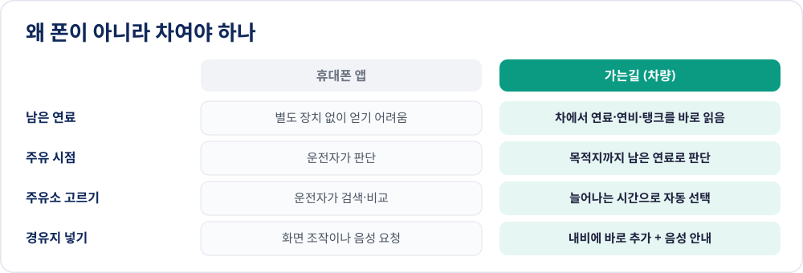
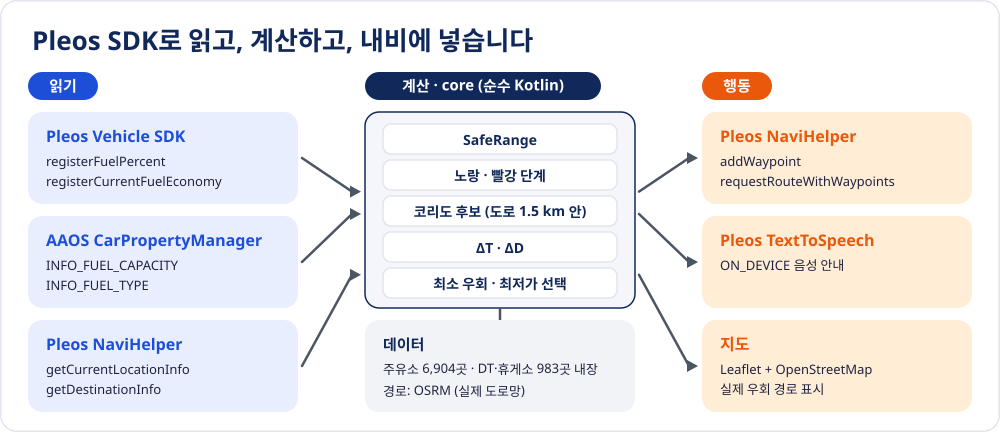
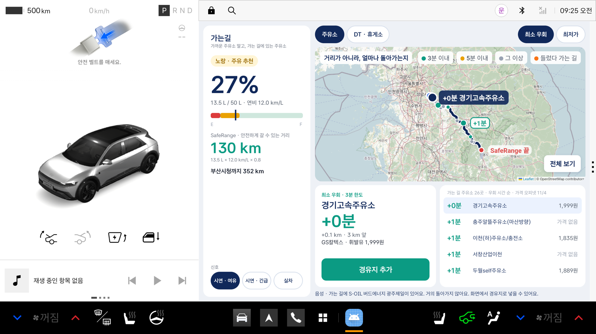
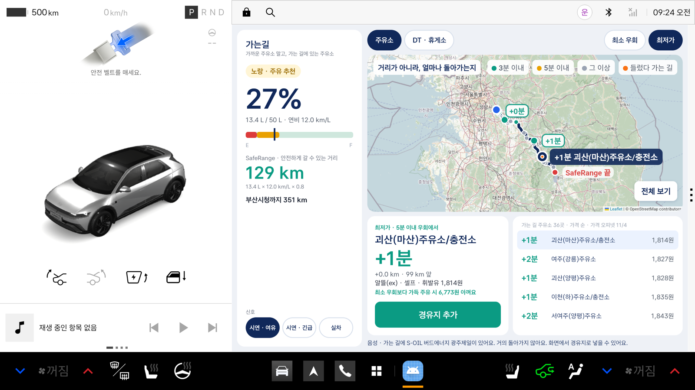
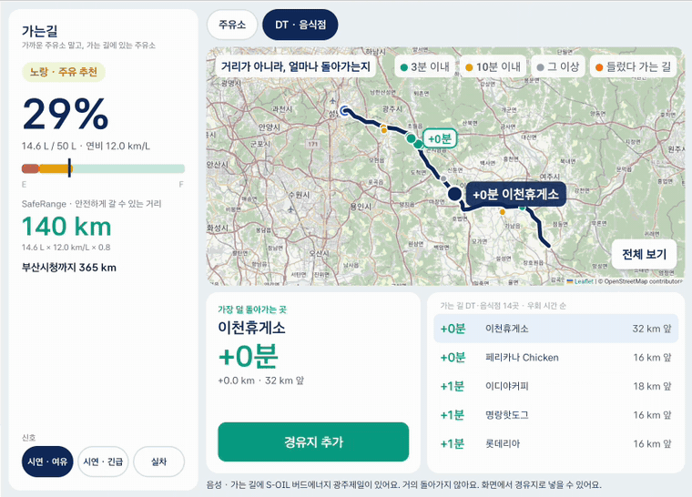
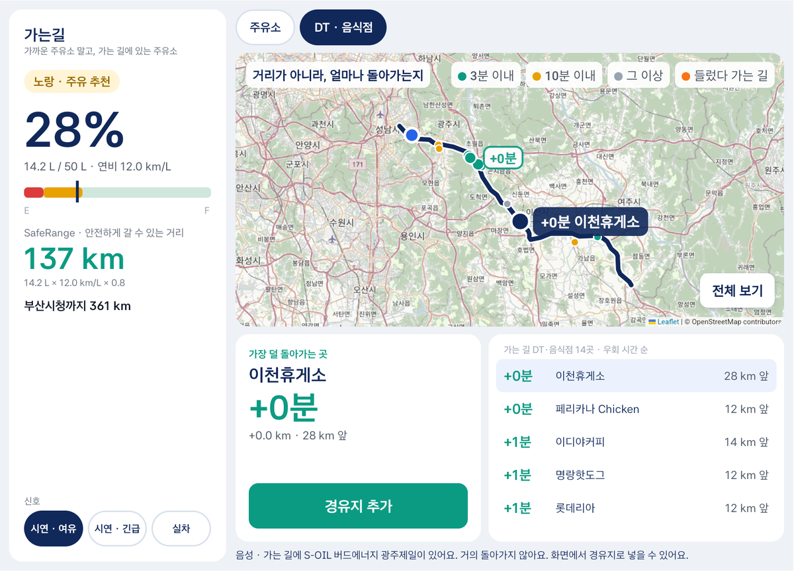
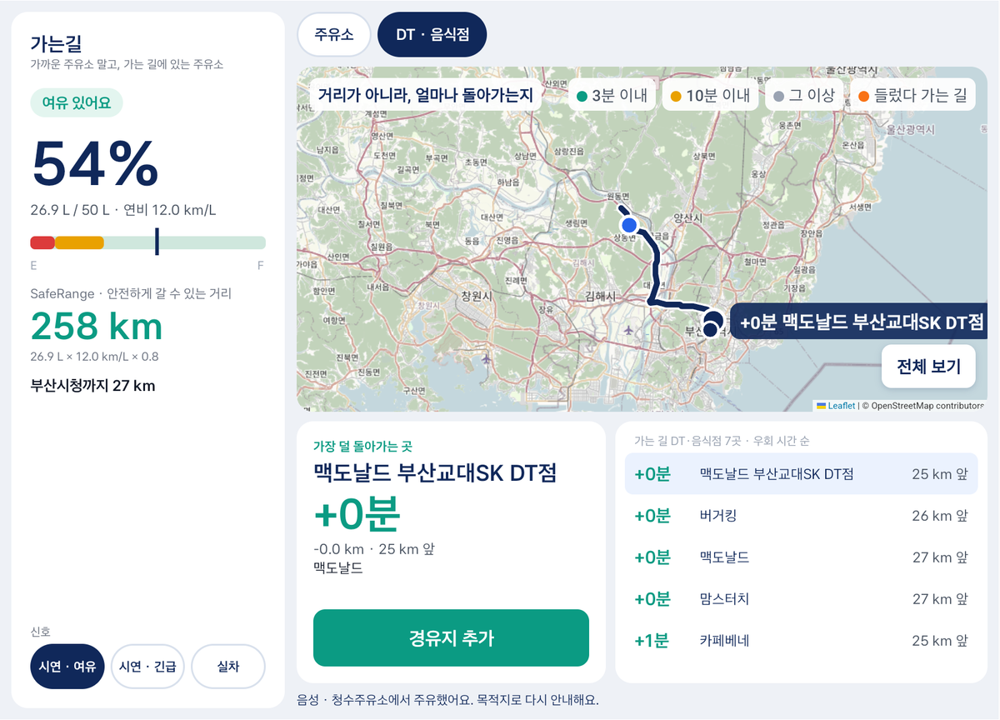
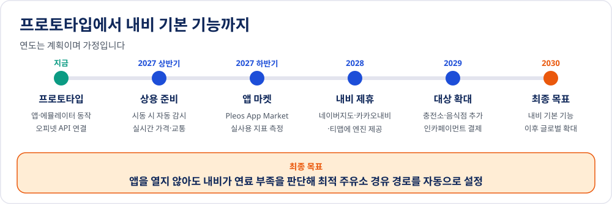

# 현재 경로 기반 주유소 추천

## 거리로 나타내는 기존 지도 ❌, 우회 시간을 통한 새로운 지도의 지표!!

**가는길은 연료가 모자라면 자동으로 가장 덜 돌아가는 주유소를 Pleos 내비 경유지에 넣습니다.**


**[시연 영상](#4-실제-화면) · [DT·음식점 시연](#5-확장-dt음식점까지-같은-엔진으로) · [APK](apk/CRAVE_OnTheWay_release.apk) · [바로 실행](#7-실행-방법)**

<sub>현대자동차그룹 차량용 앱 개발 공모전 (Pleos Connect) · 팀 CRAVE</sub>

| 평가 항목 | 보는 곳 |
|---|---|
| 차량특화성 | [1 왜 차 안에서](#1-왜-차-안에서) |
| 창의성 | [2 핵심 아이디어](#2-핵심-아이디어) · [5 확장](#5-확장-dt음식점까지-같은-엔진으로) |
| 기술 활용성 | [3 동작 구조](#3-동작-구조) |
| 사업성 | [6 사업성](#6-사업성) |
| 개발 산출물 | [4 실제 화면](#4-실제-화면) · [7 실행 방법](#7-실행-방법) |

---

## 1. 왜 차 안에서

| 누구 | 문제 | 가는길 |
|---|---|---|
| 운전자 | 주행 중에는 주유소를 찾아 비교하기 어렵습니다 | 연료가 여유 있을 때 먼저 추천합니다 |
| 운전자 | 가까워 보여도 IC로 나갔다 오면 크게 늦습니다 | 늘어나는 시간으로 고릅니다 |
| 운전자 | 경고등이 켜지면 고를 곳이 줄어듭니다 | 긴급하면 경유지를 자동으로 넣습니다 |
| 동승자 | 쉴 곳을 하나씩 경유지로 넣어 봐야 합니다 | DT·음식점을 우회 시간 순으로 보여 줍니다 |



네이버 오토앱은 연료가 부족하면 주변 주유소를 안내하고, 티맵은 음성 요청으로 주유소를 경유지에 넣으며, 카카오내비 AI는 경로상 위치를 보여 줍니다. 가는길은 **주변이 아니라 가는 길**을 기준으로 늘어나는 시간을 계산해 고르고 경유지까지 넣습니다.

## 2. 핵심 아이디어


| 측정 (32지점 중앙값) | 직선 최단 주유소 | 가는길 |
|---|---|---|
| 우회 시간 | +7.1분 | **+0.2분** (최소 우회) |
| 우회 거리 | +5.4 km | **+0.0 km** (최소 우회) |
| 주유비 | 기준 | **2,882원 절약** (최저가, 33 L) |

앱과 같은 코드로 경로 8개를 측정했습니다. 직선 최단은 비교 기준이며 실제 운전자의 선택을 잰 값은 아닙니다 → [docs/savings.md](docs/savings.md)

## 3. 동작 구조




ΔT·ΔD 한도는 실제 경로 8개로 정했습니다 → [docs/calibration.md](docs/calibration.md)

## 4. 실제 화면

Pleos Connect Emulator v2.1.0 화면 녹화입니다(1분 42초, 컷 편집 없음). 소리는 없고, 음성 안내 문구는 화면 맨 아래 "음성" 줄에 표시됩니다.

https://github.com/user-attachments/assets/95fbefb2-c413-4fac-a42a-93602c8fb905

**0:04** 노랑 추천 · **0:21** 최저가 · **0:45** IC 우회 경로 · **0:54** 경유지 추가 · **1:06** 긴급 자동 경유지 · **1:19** 주유 후 여유 단계

| | |
|---|---|
|  **노랑**: 가장 덜 돌아가는 곳 추천 |  **최저가**: ΔT 10분 안에서 가장 싼 곳 |
|  **내 방향 휴게소** +1분 |  **반대 방향 휴게소** +12분 |
|  **빨강**: 자동 경유지 + 음성 |  내비에 **경유지 1개 포함** |

## 5. 확장: DT·음식점까지 같은 엔진으로



**거리 순이 아니라 우회 시간 순으로 뜹니다.** 앱의 DT·음식점 탭을 시연 주행으로 녹화해 출발, 고속도로, 부산 구간을 이어 붙였습니다.

| | |
|---|---|
|  **음식점**: 28 km 앞 휴게소가 12 km 앞 음식점보다 위 |  **DT**: 25 km 앞 카페베네(+1분)가 27 km 앞 매장(+0분)보다 아래 |


주유소, DT·휴게소, 음식점·카페는 같은 코드(`corridor`, `Osrm.detours`)로 동작합니다. 음식점은 장소 데이터만 더했고 우회 계산과 경유지 추가는 그대로 씁니다.

## 6. 사업성

> MAU와 Retention은 출시 전 모델 추정치이며, 출시 후 실측값으로 바꿉니다. **(가정)** 은 공개 자료가 없어 팀이 정한 값입니다.

### 타깃 고객

**차를 쓰는 모든 운전자**입니다. 주유가 필요한 차부터 지원하고, 충전소를 지원하면 전기·LPG 차로 넓힙니다. 먼 길일수록 일찍 알려 줍니다.

| 목적지까지 거리 | 추천이 시작되는 남은 연료 (탱크 50 L, 연비 12 km/L) |
|---|---|
| 20 km | 2.1 L (4%) |
| 100 km | 10.4 L (21%) |
| 150 km 이상 | 15.6 L (31%) |

| 시장 | 규모 | 기준 |
|---|---|---|
| 국내 등록 차량 | 2,667.6만대 | 2026년 6월 말 |
| 휘발유·경유·하이브리드 | 2,352.4만대 (88%) | 2026년 6월 말 |
| 지금 설치 가능한 차 | 최대 약 5.3만대 | 그랜저 6–10월 + 아반떼 9–10월 국내 판매 합 |
| 2030년 국내 탑재 연료차 | 약 242만대 | 그룹 목표 2,000만대 × 국내 판매 비중 17.3% × 연료차 70%(가정) |

### 예상 MAU

모든 차의 내비에 탑재된 상태를 전제로 한 **상한**입니다(가정). 차량 한 대는 월평균 **주유 2.8회 + DT 0.3회(가정) = 3.1회** 이용하고, 그 달에 1회 이상 이용하는 차량은 **86.5%** 입니다.

| 시점 | 탑재 연료차 | MAU 상한 | 월 이용 횟수 상한 |
|---|---|---|---|
| 2028년 말 (그랜저·아반떼) | 약 43만대 (가정) | 37만 | 135만회 |
| 2030년 말 (Pleos 탑재 전체) | 약 242만대 (가정) | 209만 | 759만회 |
| 국내 연료차 전체 | 2,352만대 | 2,034만 | 7,370만회 |

국내 전체 2,034만은 티맵 MAU 1,512만(2026년 5월)보다 큰 이론적 상한입니다. Pleos 순정 내비만 쓰면(이용률 68%) 2030년 상한은 142만이어서 내비 제휴가 필요합니다.

### Retention Rate

이번 달 이용한 차가 N개월 뒤 그 달에 다시 이용할 비율입니다. 운행 빈도와 주유·DT 횟수로 **91%**, 여기에 월 이탈 2%(가정)를 넣었습니다. 내비 내장 후의 값입니다.

| 기간 | 1개월 | 3개월 | 6개월 | 12개월 | 24개월 |
|---|---|---|---|---|---|
| Retention | 90% | 86% | 81% | 72% | 56% |

### 사업성 지표

| 지표 | 값 | 기준 |
|---|---|---|
| 차량 1대 연간 가치 | 1.4시간, 3.5만원 | 월 1회 이용(가정) |
| 2030년 연간 절약 총량 | 약 340만 시간, 약 840억원 | 242만대(가정), 월 1회 이용(가정) |
| 연간 주유 거래액 | 1대 174만원, 2030년 4.2조원 | 연 11,242 km, 12 km/L(앱 기본값), 1,855원/L |
| 제휴 수익 시나리오 | 1대 연 937원, 2030년 23억원, 국내 전체 220억원 | 결제 연동 10%(가정), 리터당 10원(가정) |
| DAU/MAU | 약 12% | 활성 차량당 월 3.6회 이용 |

### 사용자 확보와 확대 계획



앱 마켓으로 탑재 차량 운전자를 먼저 확보하고, 적용 차종 확대와 내비 제휴로 스마트폰 내비 이용자까지 넓힙니다. 네이버지도와 카카오내비는 이미 플레오스 커넥트에 입점해 있어 먼저 제안하고, 스마트폰 내비 점유율 1위인 티맵(71.9%, 네이버지도 14.5%, 카카오내비 9.2%)까지 넓힙니다.

사용자에게는 무료로 제공하고 광고비로 추천 순서를 바꾸지 않습니다. 앱 마켓 입점과 제휴는 심사·협의가 필요하며 확정된 사항이 아닙니다.

<details>
<summary>계산 근거와 출처</summary>

- **주유:** 자가용 승용차 월평균 3.9회, 주평균 운행 5.5일 ([KTDB 자동차이용실태조사 2012](https://www.ktdb.go.kr/site/www/dowonload/car/2012_survey01.pdf)). 운행일당 16.3% × 평균 운행 17.4일 = 월 2.8회. 1회 주유량 33.0 L로 소비량을 환산한 값은 월 2.4회입니다.
- **운행 빈도:** [나우앤서베이 2020, 1,505명](https://www.datasom.co.kr/news/articleView.html?idxno=104444). 그 달 이용 확률 = 1 − (1 − 운행일당 이용 확률 18.05%)^월 운행일.
- **DT:** 공식 통계가 없어 역산했습니다. [스타벅스 2025년 매출 3조2,380억원, 매장 2,114곳](https://v.daum.net/v/btFjkI4qkz) ÷ 객단가 8,000원(가정) × DT 주문 40%(가정) = 매장당 일 210대. [스타벅스 DT 500곳](https://ceoscoredaily.com/page/view/2024122015353652370) + [맥드라이브 300곳](https://www.hankyung.com/article/202507211177i)에 적용하고, 다른 브랜드 30%(가정)를 더해 월 664만대 ÷ 2,352만대 = 0.3회.
- **시장:** [등록 대수](https://www.mt.co.kr/estate/2026/07/30/2026072915093667802), [플레오스 커넥트 2,000만대](https://zdnet.co.kr/view/?no=20260430015244), [앱 마켓 18종](https://www.fnnews.com/news/202609070949054267), [주행거리](https://www.fnnews.com/news/202606291005221113)
- **판매:** 현대차 [6월](https://www.hyundaimotorgroup.com/ko/news/hyundai-motor-company-june-2026-sales), [7월](https://www.hyundaimotorgroup.com/ko/news/hyundai-motor-company-july-2026-sales), [8월](https://www.hyundaimotorgroup.com/ko/news/hyundai-motor-company-august-2026-sales), [9월](https://www.hyundaimotorgroup.com/ko/news/hyundai-motor-company-september-2026-sales), [10월](https://www.hyundaimotorgroup.com/ko/news/hyundai-motor-company-october-2026-sales), [현대차 2025](https://www.hyundaimotorgroup.com/ko/news/hyundai-motor-company-sales-4138180-units-2025), [기아 2025](https://www.hyundaimotorgroup.com/ko/news/kia-2025-sales-3135803-units)
- **내비:** [순정 내비 68%](https://www.consumerinsight.co.kr/autoinsight/abview?no=3294&id=pr4_list), [앱 점유율](http://www.breaknews.com/1248191), [지도 앱 MAU](https://www.igaworks.com/blog/outstanding-0618), [네이버](https://www.kukinews.com/article/view/kuk202606260026), [티맵](https://www.hankyung.com/article/202509179328i), [카카오내비](https://www.inews24.com/view/1963419)
- **기타:** [Retention(Braze, AppsFlyer 재인용)](https://www.braze.com/resources/articles/mobile-app-retention.md), [Stream(OneSignal 재인용)](https://getstream.io/blog/app-retention-guide/), [인카페이먼트](https://www.genesis.com/kr/ko/members/my-genesis-app/mobility-services/in-car-payment.html), [OSRM 정책](https://github.com/Project-OSRM/osrm-backend/wiki/Demo-server)

</details>

## 7. 실행 방법

**APK:** [apk/CRAVE_OnTheWay_release.apk](apk/CRAVE_OnTheWay_release.apk)

```bash
adb install -r apk/CRAVE_OnTheWay_release.apk
adb shell am start -n ai.ontheway.app/.MainActivity
```

왼쪽 아래 버튼으로 신호를 고릅니다.

| 버튼 | 동작 |
|---|---|
| 시연 · 여유 | 판교에서 부산시청까지 1초에 1 km. 연료 30%로 노랑 추천, 그대로 두면 빨강 자동 경유지 |
| 시연 · 긴급 | 연료 9%로 바로 빨강, 자동 경유지 + 음성 |
| 실차 | Vehicle SDK와 내비 신호 사용. 내비에서 목적지를 정하면 계산 |

**테스트 환경:** Pleos Connect Emulator v2.1.0 (API 34, arm64, 2560×1440) · macOS Apple Silicon · Android SDK 34 · AGP 9.4.1 · Gradle 9.8.2 · Kotlin 2.4 · Pleos SDK Vehicle 2.3.2, NaviHelper 3.0.5, TextToSpeech 3.3.1

**필요한 설정**
- 경로와 지도 타일에 네트워크가 필요합니다. 주유소 목록과 가격은 앱에 들어 있습니다.
- 시연이 "신호를 기다리는 중"에서 멈추면 `emulator -avd <AVD 이름> -dns-server 8.8.8.8`로 다시 시작합니다.
- 에뮬레이터 차량은 전기차라 실차 모드의 연료는 25% 가정값으로 표시합니다.

## 8. 부록

### 한계

- 앱을 직접 열어야 동작합니다. 시동 시 자동 시작은 아직 없습니다.
- 기어·속도 신호는 아직 쓰지 않아 주행·정차를 구분하지 않습니다.
- 음식점은 OSM에 브랜드가 표시된 매장 5,819곳만 넣었고(이름 있는 곳 약 94,000곳 중), 영업시간은 확인하지 않습니다.
- 오피넷 주유소 6,312곳은 위치를 못 붙여 빠졌고, 공식 좌표가 없는 곳은 매칭 오차가 남아 있습니다([docs/stations.md](docs/stations.md)).
- 가격은 내려받은 날 기준이고, ΔT는 실시간 교통을 반영하지 않습니다(OSRM).
- 실제 차량이 아닌 Pleos 에뮬레이터에서 확인했습니다.

<details>
<summary>소스 빌드와 데이터 갱신</summary>

```bash
cd android
export JAVA_HOME="/Applications/Android Studio.app/Contents/jbr/Contents/Home"
./gradlew :core:test :app:assembleDebug     # 엔진 단위 테스트 + 디버그 APK
./gradlew :core:calibrate                    # (네트워크) 한도 값 근거 → docs/calibration.md
./gradlew :core:savings                      # (네트워크) 절약 측정 → docs/savings.md
```

release 빌드는 `android/local.properties`에 서명 정보를 넣고 `./gradlew :app:assembleRelease` (키·비밀번호는 커밋하지 않음):

```
release.storeFile=/path/to/release.jks
release.storePassword=…
release.keyAlias=…
release.keyPassword=…
```

주유소 데이터 다시 만들기 (OpenStreetMap 한국 추출본 약 290 MB):

```bash
curl -LO https://download.geofabrik.de/asia/south-korea-latest.osm.pbf
brew install osmium-tool && pip install shapely
python3 tools/build_places.py data/opinet/사업자_기본정보_주유소_20261104.csv data/opinet/현재_판매가격_주유소_20261104.csv south-korea-latest.osm.pbf
```

공식 좌표는 `android/local.properties`에 `opinet.key=…`를 넣고 받습니다. 키가 300회 호출 뒤 응답을 멈춰서, 매일 다시 실행하면 멈춘 곳부터 이어 받습니다.

```bash
pip install pyproj
python3 tools/fetch_opinet.py data/opinet/사업자_기본정보_주유소_20261104.csv
```

</details>

<details>
<summary>폴더 구조</summary>

```
android/core/                       순수 Kotlin 엔진 + 단위 테스트 + calibrate·savings
android/app/                        Pleos 앱: 차량 신호, 내비, 음성, 시연 주행, 화면, 지도
android/app/src/main/assets/        places.csv (주유소·DT·음식점), map.html (Leaflet 지도)
data/opinet/                        오피넷 원본 CSV, API 공식 좌표
tools/                              build_places.py, fetch_opinet.py
docs/                               calibration.md, savings.md, stations.md, 그림
apk/CRAVE_OnTheWay_release.apk      제출용 release APK
```

</details>

### 데이터 출처

| 무엇 | 출처 | 규모 |
|---|---|---|
| 주유소 정보·가격·공식 좌표 | [오피넷](https://www.opinet.co.kr/user/opdown/opDownload.do), 한국석유공사 (저작권은 한국석유공사에 있으며, 수익 목적 이용은 사전 협의 필요) | 전국 10,315곳, 가격 기준일 2026-11-04 |
| 주유소 위치 | 오피넷 API 공식 좌표 296곳 + 주소 매칭 ([방식과 정확도](docs/stations.md)) | 오피넷 4,003곳 + OSM 주유소 2,901곳 |
| 지도·도로·DT·음식점 | © OpenStreetMap contributors (ODbL) | DT·휴게소 983곳, 브랜드 음식점·카페 5,819곳 |
| 경로 | OSRM (Project OSRM 공개 서버) | 실시간 |
| 지도 라이브러리 | Leaflet 1.9.4 (BSD-2-Clause, `android/app/src/main/assets/leaflet/LICENSE`) | |
